# Piano Practice

A private piano studio in the browser: a calm practice room that runs on your Mac and on the
iPad on the music stand. It shows the score (or falling notes), plays it on a sampled grand
piano, listens to your MIDI piano, waits for the right notes, times your rhythm, remembers how
every bar went and lays out what to practise each day. A teacher companion reads your playing
and answers in letters.

No account, no server in the cloud, no tracking. Everything stays on your Mac and iPad.

<p align="center">
  <picture>
    <source media="(prefers-color-scheme: dark)" srcset="docs/screenshots/today-dark.png">
    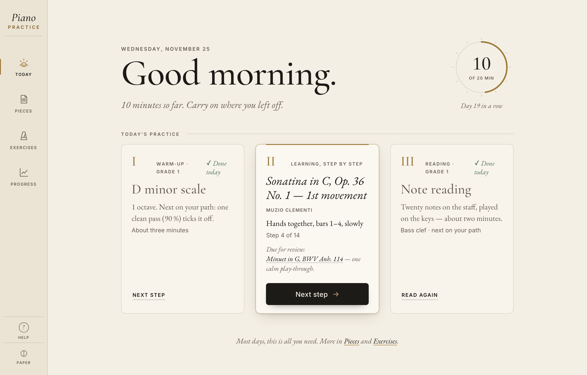
  </picture>
</p>
<p align="center">
  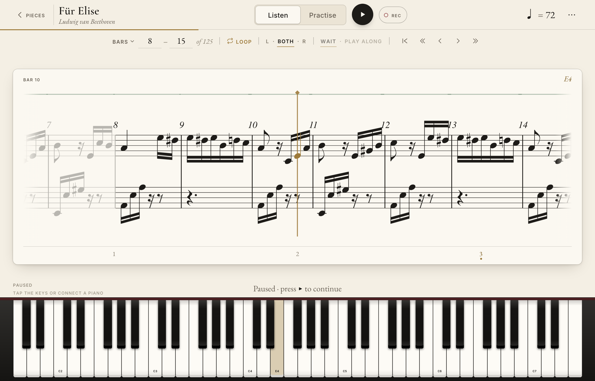
  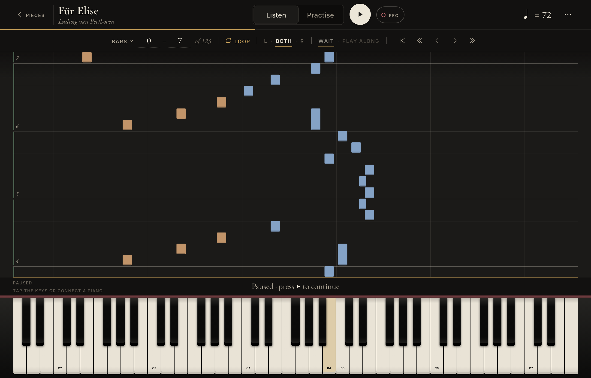
</p>
<p align="center"><sub><i>Today, in the Paper theme (or Concert hall, if your system is dark) · a piece in notation · the same piece as falling notes.<br>Screenshots use made-up demo practice on bundled public-domain pieces; <a href="#screenshots">more below</a>.</i></sub></p>

The first part of this file is the **guide for the student**; the [developer section](#for-developers)
follows. Inside the app, press **?** at any time for help and keyboard shortcuts.

---

## Getting started

### On the Mac

You need [Node.js](https://nodejs.org) 20 or newer and Chrome (or Edge, Brave, Opera: any
Chromium browser, which is where Web MIDI works).

```sh
npm install      # once
npm run dev      # then open http://localhost:5173
```

1. Plug the piano in with USB.
2. Open any piece, then **⋯ → Connect piano** and allow MIDI. The ⋯ menu shows the piano's name
   once it is connected; with several inputs, pick one or keep "All inputs". Once allowed, the
   piano reconnects by itself whenever you open the app.
3. The first time you open the app a short introduction shows you around and asks for your level
   and a daily goal. Skip it if you like; **Progress → Settings → Show the introduction again**
   brings it back.

Keep the terminal running while you practise: the dev server is what keeps your progress, journal,
recordings and imported scores on the Mac (see [Your data](#your-data-and-backup)).

### On the iPad (on the music stand)

The piano's USB cable goes to the Mac; the iPad shows the app. iPad Safari has no Web MIDI, so
the Mac relays your keyboard over Wi-Fi (the "bridge").

1. On the Mac: `npm run dev:ipad` (the dev server, reachable on your local network).
2. On the Mac, in Chrome: open `http://localhost:5173/bridge.html`, press **Connect piano** and
   allow MIDI. Keep this tab open. It shows the address for the iPad and the relay's delay to
   every open page (round trip; under 30 ms feels instant).
3. On the iPad, in Safari: open the address it shows, for example `http://192.168.1.20:5173/`.
   The Mac also shows it at the foot of **Today** and in **Settings → This device**, with a QR
   code to scan with the iPad's camera.
4. To keep it as an app: **Share → Add to Home Screen → Add**. It opens full screen, on the paper
   background, without Safari's bars.

<p align="center">
  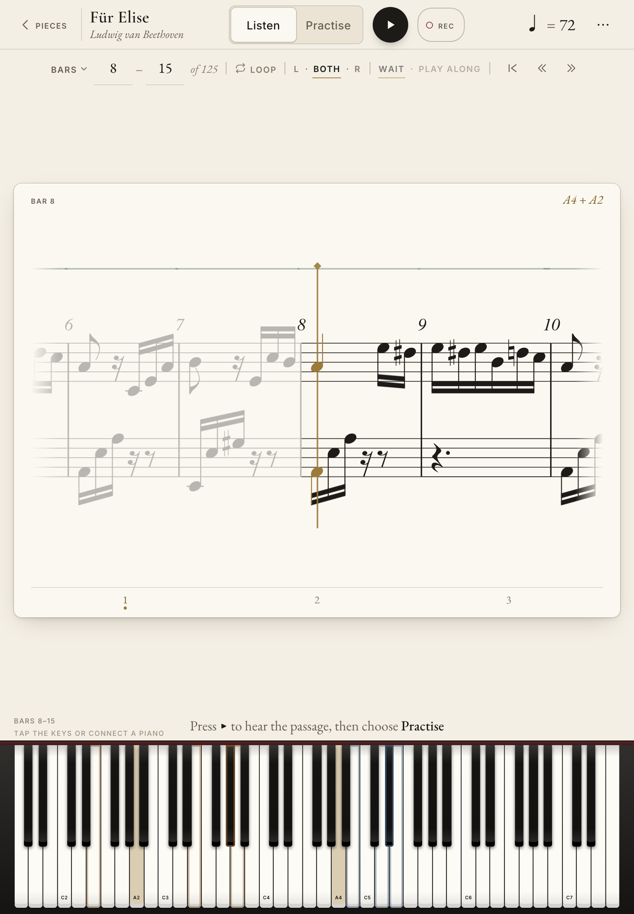
  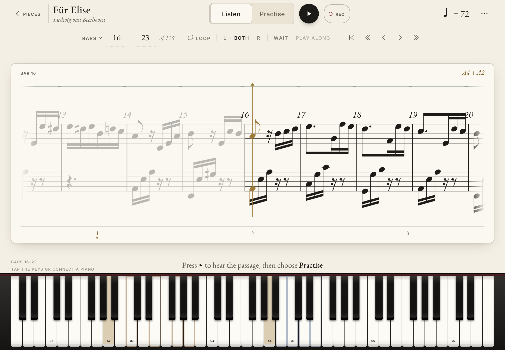
</p>
<p align="center"><sub><i>On the music stand: iPad portrait and landscape.</i></sub></p>

The bridge looks after itself: it sends a heartbeat every 3 seconds, the iPad tells *connected*
from *no signal* and *reconnecting…* (shown in the player's ⋯ menu), and when the Wi-Fi drops or the dev server restarts, both
pages reload once the Mac is reachable again and the piano reconnects by itself.

The screen stays awake while you listen or practise (and for 3 minutes after the last note) and
during the note-reading drill.

### Anywhere else: the public site

`npm run publish:site` publishes the built app (only the build: no source, no private songs) to
GitHub Pages at `https://<you>.github.io/piano-practice-site/`. It works on any device, offline after the
first visit, with on-screen keys, the microphone, or a USB piano in desktop Chrome. Progress is kept
in that browser. The teacher, the iPad relay and your Mac's imports need the Mac's dev server, so
the public site leaves them out (one quiet line in Progress says where they live) and never asks
for them. In iPad Safari, Today suggests **Add to Home Screen** once.

**Bringing practice home.** On the public site, **Progress → Backup → Take this progress to your
Mac** downloads one file. On the Mac, **Progress → Backup → Import backup** and choose it, then
**Add to this progress**: its practice, journal entries and goals join the Mac's store
(`.data/progress.json`), each one once, however often you import the same file. (**Replace
everything** is still there for restoring a whole-Mac backup.) An https page can't reach the Mac's
http server, so this file is the bridge.

**Publishing on every merge (one-time setup).** `.github/workflows/publish-site.yml` builds and
publishes the site on every push to `main`, running the same checks as `npm run publish:site`
(`tools/site-guard.mjs`: nothing private in the build; the target is public and is not this source
repo). Until it has a token it skips, without failing:

1. Publish once by hand (`npm run publish:site`) so the public repo `<you>/piano-practice-site`
   exists with Pages on its `gh-pages` branch.
2. GitHub → Settings → Developer settings → Fine-grained tokens → *Generate new token*:
   repository access **Only select repositories → piano-practice-site**, permission
   **Contents: Read and write** (nothing else).
3. In this (private) repo: Settings → Secrets and variables → Actions → *New repository secret*
   `PAGES_DEPLOY_TOKEN` with that token. Optionally a variable `PAGES_REPO` (`owner/name`) to
   publish somewhere else.

### No piano nearby?

Tap the keys on screen, or in a piece choose **⋯ → Listen with microphone**: the microphone
follows one note at a time (melodies and single notes, not chords) on any acoustic piano.

---

## The four places

There are only four places. Everything else (the player, the teacher, the settings) opens from
them and leads back with **←**.

| Place | What it is for |
| --- | --- |
| **Today** | Your home. Each day: a warm-up (the next technique step of your path), your current piece, and a short reading drill, plus your daily goal ring, your streak, pieces due for review, homework from your teacher and their latest note. Most days you never need to leave it. |
| **Pieces** | The repertoire: bundled public-domain pieces with a grade, grouped by composer like a concert programme, your own songs and imported scores, each with its status (learning, secure, polished, maintained). **Browse Mutopia** searches the whole Mutopia piano archive and converts a piece on the spot (marked *unverified*). **Import a score** takes MusicXML (`.musicxml`, `.xml`, `.mxl`), MEI or a MIDI file (`.mid`), which is quantised into a two-staff score (marked *unverified*; a loosely timed file opens in falling notes). |
| **Exercises** | Technique (scales, arpeggios, five-finger positions, chromatic scales and cadences in every key, with fingering), note reading, sight-reading, rhythm, theory lessons and ear training. |
| **Progress** | Your practice diary: today against your goal, streak, the week, bars mastered, your path through the grades (Beginner to Grade 5), goals with dates, the journal, recordings, letters from your teacher, and the settings (daily goal, where your path starts, appearance, backup, help). |

<table>
  <tr>
    <td width="33%">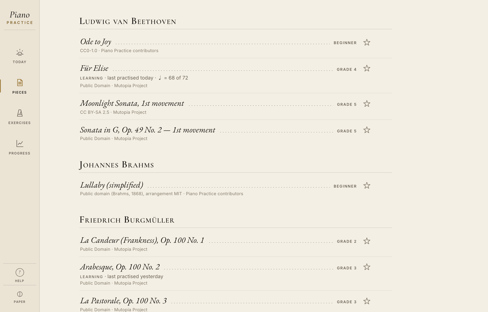</td>
    <td width="33%">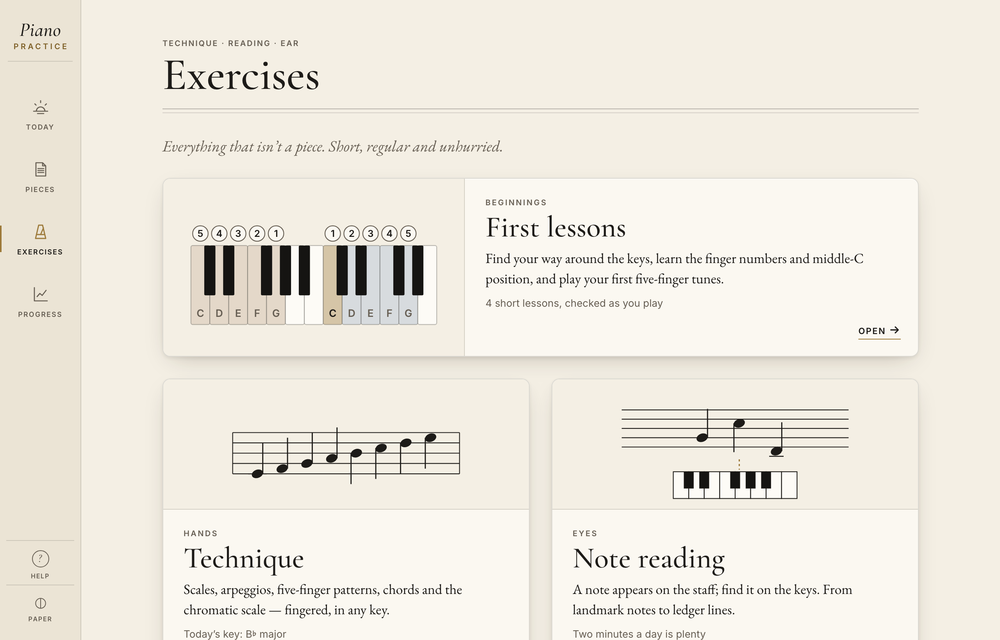</td>
    <td width="33%">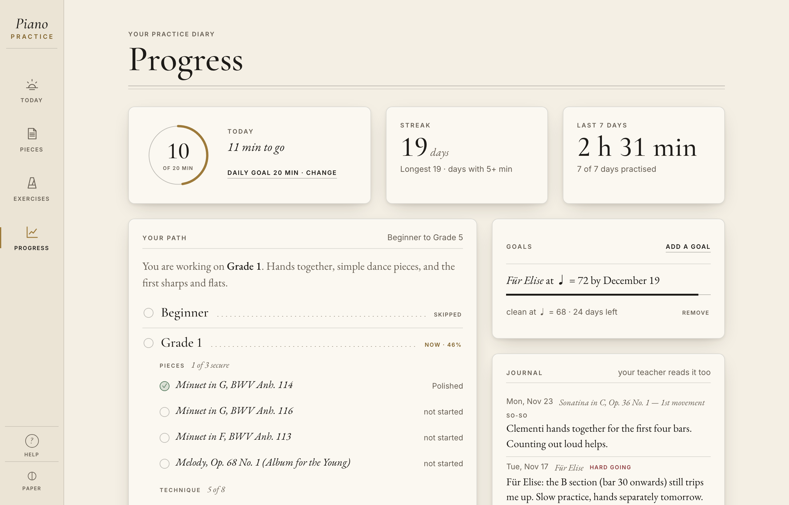</td>
  </tr>
  <tr>
    <td align="center"><sub><b>Pieces</b>: grade and status at a glance</sub></td>
    <td align="center"><sub><b>Exercises</b>: everything that isn't a piece</sub></td>
    <td align="center"><sub><b>Progress</b>: goal, streak, path, goals, journal</sub></td>
  </tr>
</table>

<p align="center">
  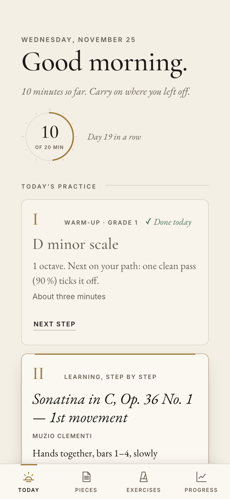
</p>
<p align="center"><sub><i>On a phone the four places move to a tab bar at the bottom.</i></sub></p>

The **teacher** is a companion, not a place: the quiet *Teacher* button opens a panel of letters
in the margin from anywhere (it needs the dev server; see [The teacher](#the-teacher)).

## A daily routine

1. Open **Today** and follow its three movements in order: *Begin the warm-up*, then your
   piece, then *Start reading*. The next one is always marked in brass.
2. In the piece, **Listen** to the section once, then **Practise** it: a few bars, hands
   separately, in *Wait*; then hands together; then *Play along* slowly; only then faster.
3. When a pass is clean, the results card says so. Loop until it is, then move to the next
   section (*Next section* on the card).
4. A short line in the journal ("How did it go?" appears after a few minutes of practice) helps
   you, and your teacher, see the week.

Fifteen minutes every day does more than an hour once a week; set your daily goal in
**Progress → Settings**.

## Practising a piece

The player has one main choice at the top, **Listen | Practise**, and a play button.

- **Listen** plays the section on the sampled grand (or a harpsichord for Bach and other Baroque
  pieces, when the instrument is *Auto*) with the score following.
- **Practise** hands the music to you. Two modes, in the section strip:
  - **Wait**: the music waits for each note or chord. Learn the notes this way, as slowly as you
    need. Stuck (three wrong notes on one chord, or a long pause after a wrong one)? The chord's
    letter names appear on its noteheads, its keys are outlined and named on the keyboard, and it
    sounds once softly. The hint goes as soon as you play it. It also offers, quietly, to
    **loop the bar slowly**: accept and the bar (and the next, if the chord was on its last beat)
    loops until you play it cleanly three times running; then the section, loop and tempo come
    back and practice carries on from the bar after. *End loop* on the stage stops it early.
  - **Play along**: a bar of count-in, then the music keeps time and marks each note early, late
    or on time.
- **Hands**: `L · Both · R` (or **H**). While you practise one hand the app plays the other.
- **Bars**: type the first and last bar, or tap *Bars* for presets: this phrase, the next
  phrase, **Practise my weak bars** (loops the bars where you make most mistakes), and
  **Chain from the start / from the end** (loop one bar, then add a bar after each clean pass).
  **Loop** (**L**) repeats the section.
- **Tempo**: tap `♩ = 72` to change it, turn on the metronome (**K**), or let it **speed up after
  clean passes** (+5 % after each pass at 95 % or better, up to the target tempo). The best clean
  tempo of every section is remembered.
- **Strategies** (⋯ → Strategy), one at a time: the slow-practice ladder, dotted and
  reversed-dotted rhythms, blocked chords from broken figures, and the memory check (the score
  hides while you play).
- **Control key**: with a MIDI piano, the top key (C8) drives the player instead of playing a
  note. It starts practising, restarts the pass from the top of the section or loop, and accepts
  the "loop this bar slowly?" offer. Choose another key in Settings → *Control key on your piano*.
  A piece that plays that key itself keeps it as a note (Settings says so).
- **View** (⋯): *Notation* (one long line that scrolls under the playhead), *Pages* (a page at
  a time, turned for you; arrow keys or a Bluetooth page-turner pedal turn it by hand) or
  *Falling notes*. Note names, zoom, theme and full screen are in ⋯ too.

<table>
  <tr>
    <td width="50%">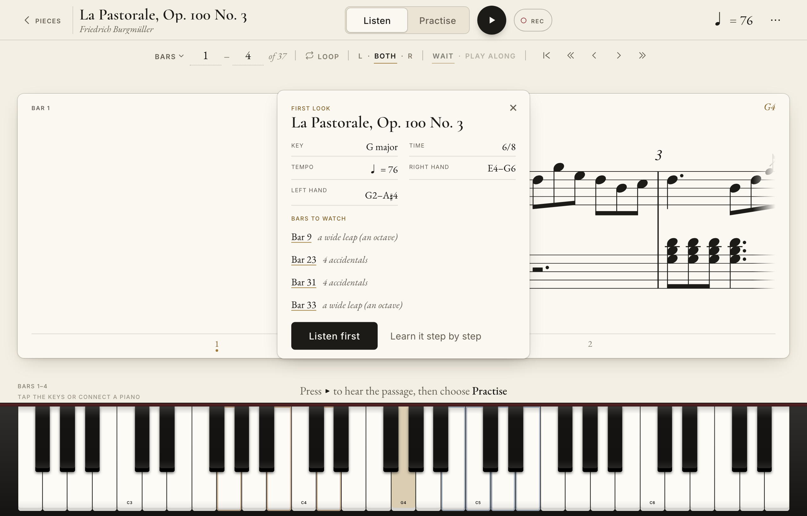</td>
    <td width="50%">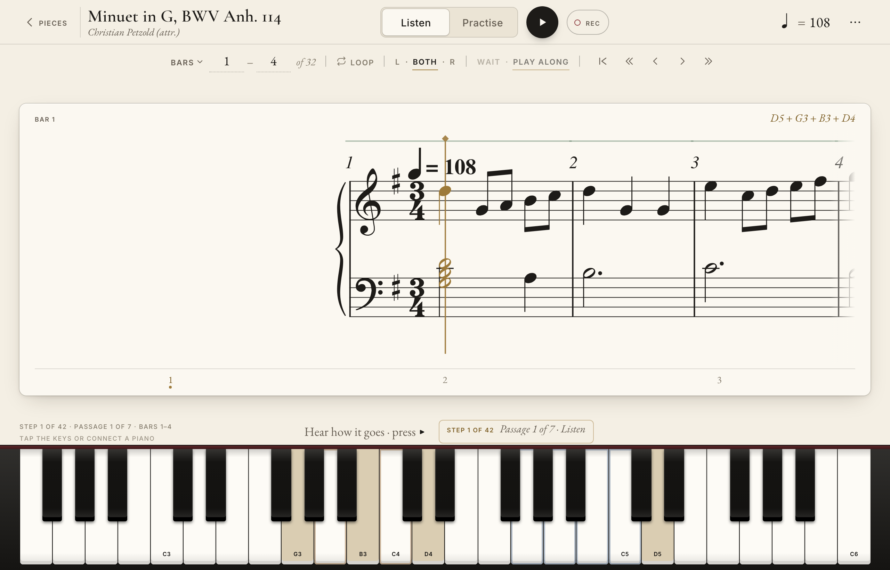</td>
  </tr>
  <tr>
    <td align="center"><sub>Before the first play, a <b>first look</b>: key, time, range of each hand, bars to watch</sub></td>
    <td align="center"><sub><b>Learn it step by step</b>: one <i>Next step</i> button through the passages</sub></td>
  </tr>
</table>

After each pass a **results card** gives your accuracy, the bars and notes that went wrong, and,
with a real piano, your evenness, dynamics against the score's marks, legato and pedalling. A
quiet heat strip above the score shows how each bar is going over the days.

<table>
  <tr>
    <td width="50%">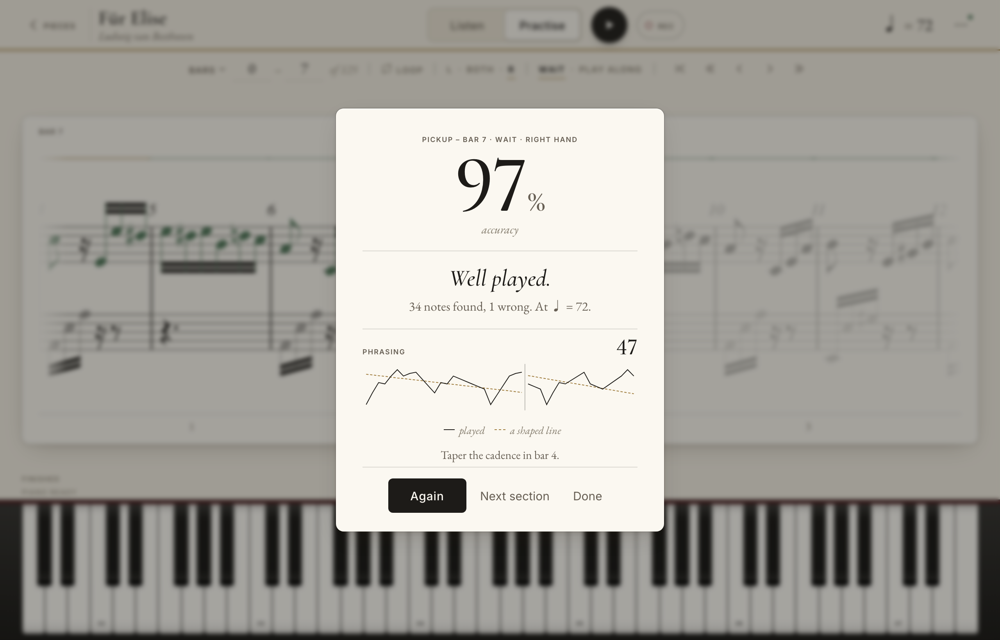</td>
    <td width="50%">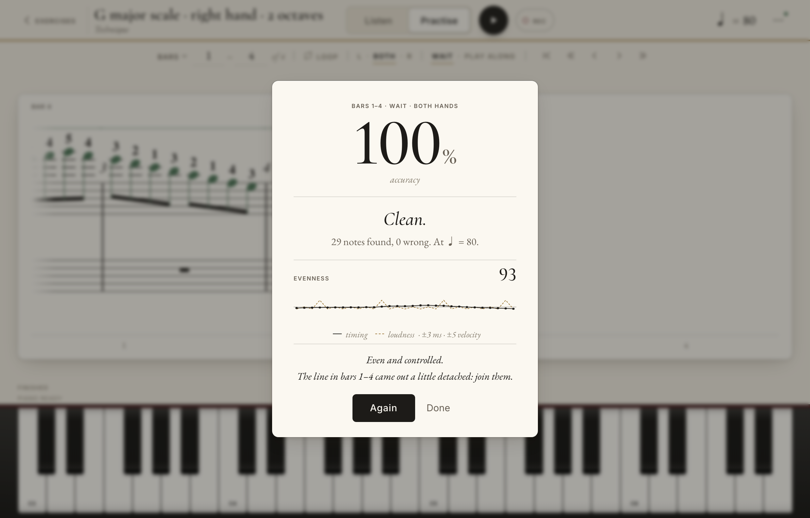</td>
  </tr>
  <tr>
    <td align="center"><sub>A piece: accuracy, notes found, and the <b>phrasing</b> of the line</sub></td>
    <td align="center"><sub>A scale: <b>evenness</b> of timing and loudness, note by note</sub></td>
  </tr>
</table>

### Keyboard shortcuts

| Where | Keys |
| --- | --- |
| Anywhere | **?** help · **Tab** / **Shift+Tab** move · **Esc** closes a menu, card or dialog |
| Player | **Space** play/pause · **P** practise · **L** loop · **H** hands · **K** metronome · **M** sound · **N** note names · **R** record · **←/→** note · **Shift+←/→** bar · **+/−** zoom |
| Pages view | **→**, **↓**, **Page Down** next page · **←**, **↑**, **Page Up** previous page |
| Bar boxes | **↑/↓** one bar later/earlier · **Enter** apply · **Esc** cancel |
| Note reading | **H** show the name · **O** any octave counts · **Enter** next round |
| Rhythm | **Space** tap · **Enter** start / next round |
| Theory, ear | **1–9** choose an answer |
| Pieces | **↓** from the search into the list · **↑/↓** move · **Esc** clear the search |
| Teacher | **Enter** send · **Shift+Enter** new line · **Esc** close |

## Exercises

- **Technique**: build any scale, arpeggio, five-finger position, chromatic scale or cadence
  (I–IV–V–I) in any key, hands separately or together, with fingering. With a real piano you get
  an evenness graph (timing and loudness of every note).
- **Note reading**: ten levels from landmark notes to ledger lines and key signatures; it gives
  you more of the notes you miss.
- **Sight-reading**: a fresh short piece at your level each time, played in Play along.
- **Rhythm**: read and tap rhythms, from crotchets to syncopation and triplets.
- **Theory**: short lessons with checks: note values, time and key signatures, intervals,
  triads and inversions, cadences, and a circle-of-fifths explorer.
- **Ear training**: intervals, chord qualities, cadences and melodic dictation.

<table>
  <tr>
    <td width="50%">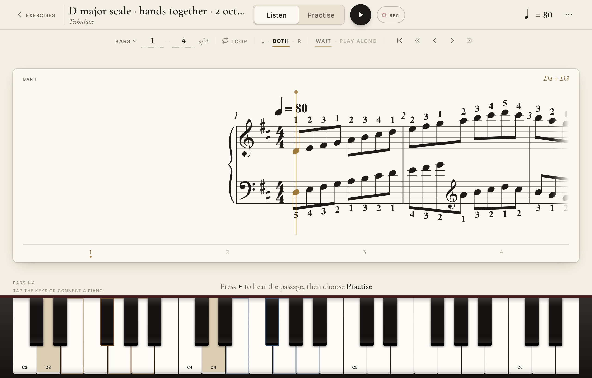</td>
    <td width="50%">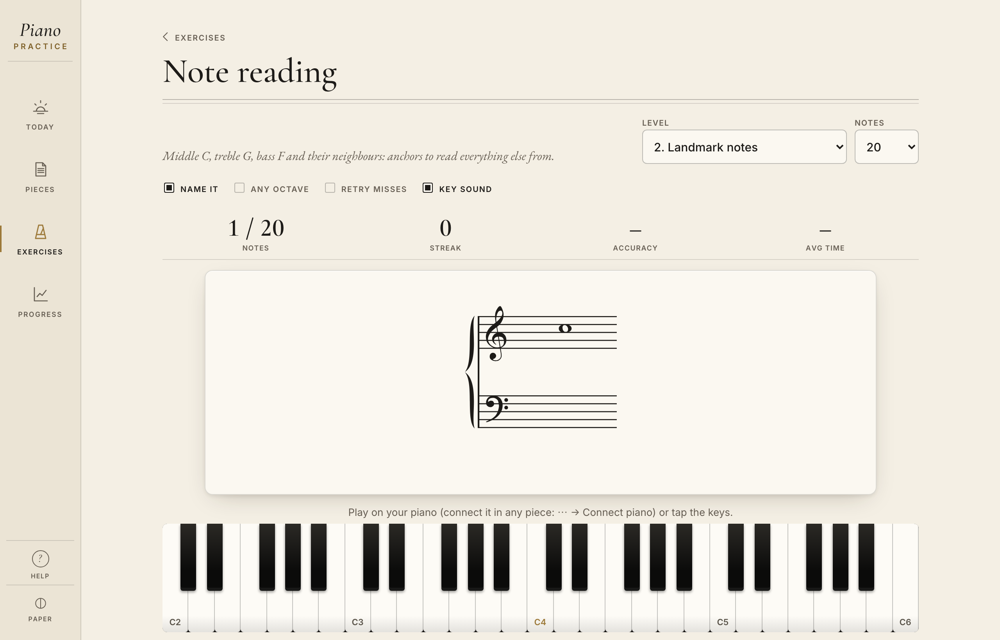</td>
  </tr>
  <tr>
    <td align="center"><sub><b>Technique</b>: any scale in any key, with fingering</sub></td>
    <td align="center"><sub><b>Note reading</b>: find the note on the keys</sub></td>
  </tr>
  <tr>
    <td>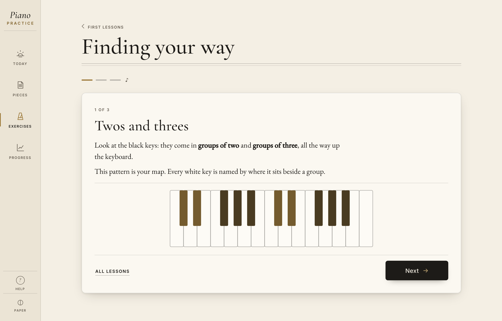</td>
    <td>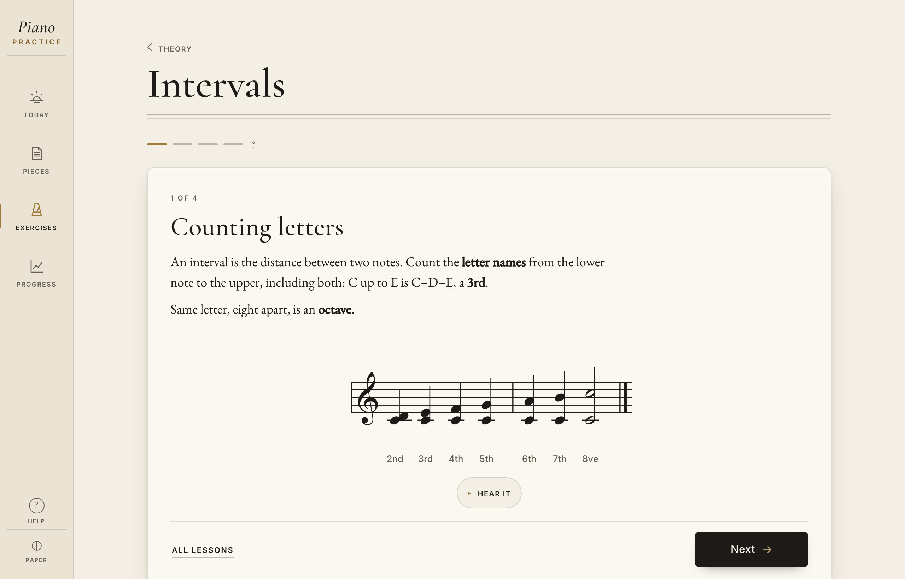</td>
  </tr>
  <tr>
    <td align="center"><sub><b>First lessons</b>: keyboard geography for beginners</sub></td>
    <td align="center"><sub><b>Theory</b>: short lessons with checks</sub></td>
  </tr>
</table>

## Recordings and mock exams

Press **Rec** (**R**) in the player to record a take from your piano. **⋯ → Recordings…** lists
your takes per piece: play one back on the sampled piano with the score following, compare it with
the score (timing per beat, wrong and missed notes, dynamics), print the report, export MIDI, or
**Send to teacher**. A **mock exam** strings two or three pieces, a scale and a short
sight-reading piece together and gives you a results sheet.

<p align="center">
  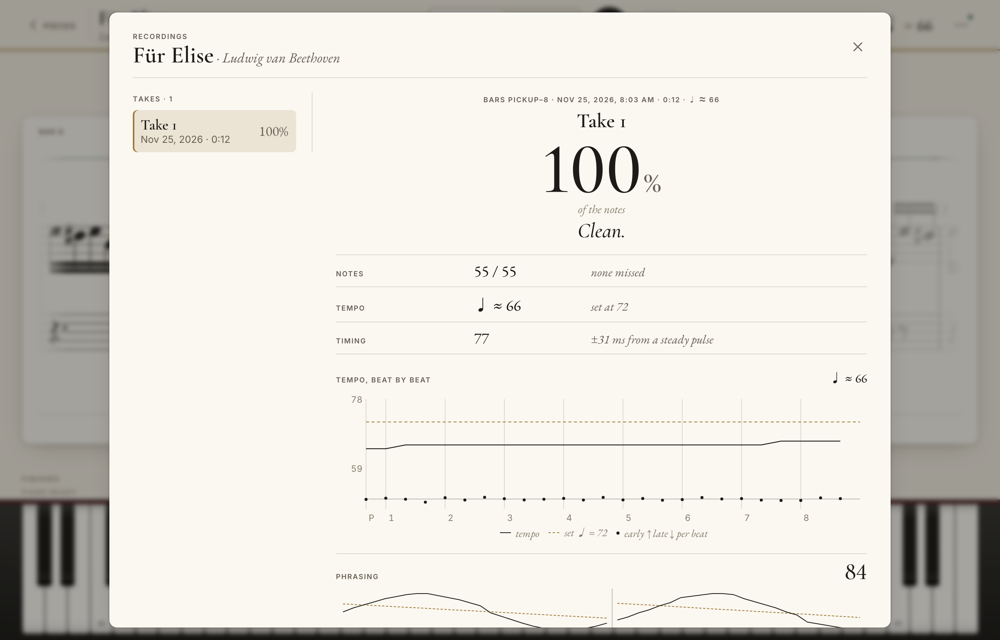
</p>
<p align="center"><sub><i>A take compared with the score: notes, tempo, timing beat by beat, phrasing.</i></sub></p>

## Progress

**Progress** is the diary: today against your daily goal, the streak, the last 14 days and 12
weeks, every piece with its status and best accuracy, the keys your technique has covered, note
reading over time, your path through the grades, goals with dates and the journal.

<p align="center">
  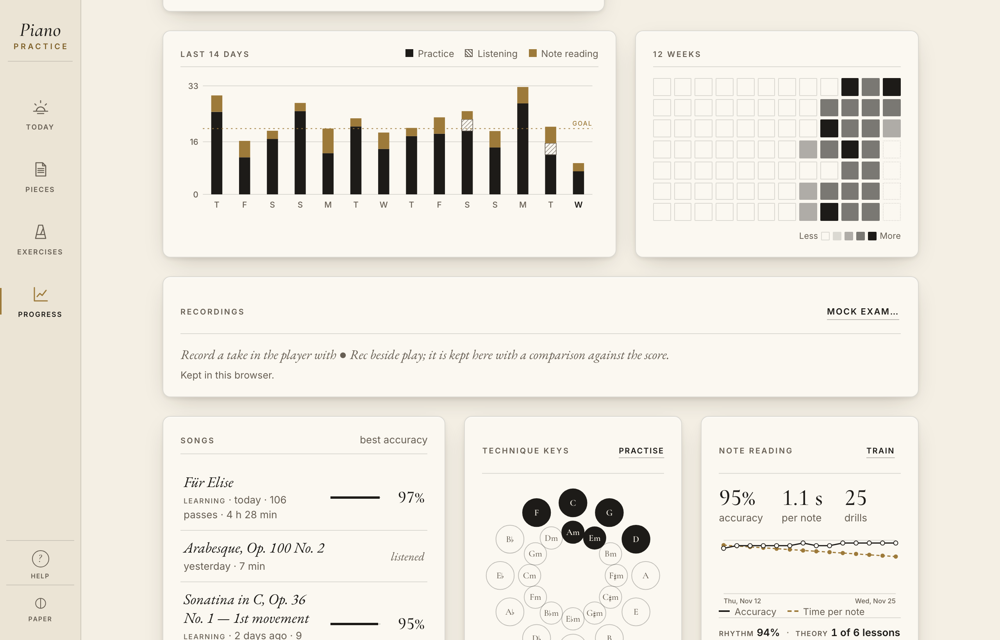
</p>

## The teacher

The Teacher panel is answered by a Claude Code session on your Mac using the brief in
`teacher/prompt.md` and the command-line tool `teacher/cli.js`. Messages you write land in
`.teacher/`; replies appear in the panel at once. The teacher can see what you share (the piece,
section, your last results), suggests concrete next steps as buttons (open a section at a tempo,
loop the weak bars…), sets homework that appears on Today, writes a weekly letter shown on
Progress and can review a recording bar by bar. The panel only appears with the dev server; a
static build has no teacher.

<p align="center">
  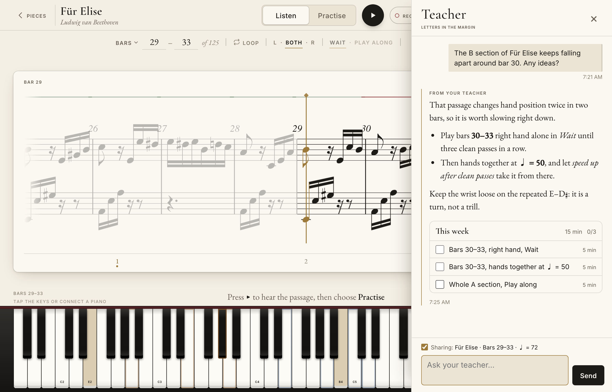
</p>
<p align="center"><sub><i>Letters in the margin (a generic sample conversation): advice, and a plan to tick off.</i></sub></p>

## Your data and backup

- **With the dev server** (the normal way): progress and journal in `.data/progress.json`,
  recordings in `.data/recordings/`, the teacher's letters and your profile in `.teacher/`,
  imported scores in `public/songs/local/imports/`. Every device using the server (the iPad too)
  shares them. All of these folders are git-ignored.
- **In a static build** (no dev server) everything stays in that browser's storage (local
  storage and IndexedDB); clearing the site's data clears it.
- **Per-browser settings**: each piece's section and tempo, the view, theme and sound settings.

**Backup**: **Progress → Settings → Export my data** downloads one JSON file with your progress,
journal, teacher letters and profile, imported scores, recordings and settings. **Import backup**
shows what a file contains and asks before replacing anything; the previous state is kept in
`.data/backups/`.

## Troubleshooting

**The piano isn't heard.**
- Use Chrome or another Chromium browser on the Mac (Safari and Firefox have no Web MIDI).
- ⋯ → *Connect piano*, and allow MIDI when asked. If you blocked it once, allow it again in the
  site settings (the padlock in the address bar) and reload.
- Unplug and replug the USB cable; the ⋯ menu lists inputs as they come and go. Pick your piano
  instead of "All inputs" if another device sends notes.
- A key keeps sounding: ⋯ → *Release keys*.

**The iPad doesn't get the piano.**
- Was the dev server started with `npm run dev:ipad` (not `npm run dev`)? Only that one is
  reachable from the network.
- Keep `bridge.html` open in Chrome on the Mac, with the piano connected there. The player's ⋯
  menu on the iPad shows the relay's state: *connected*, *no keyboard connected on the Mac*,
  *open bridge.html on the Mac*, *no signal from the Mac* or *reconnecting…*.
- Mac and iPad must be on the same Wi-Fi. If the address changed (a new network), open the one
  `bridge.html` shows now.
- A long delay: check the latency shown on `bridge.html`, and calibrate (below).

**Something else is wrong.** In a piece, **⋯ → Settings…** holds the view, note names,
fingering, sound and input latency; **Diagnostics** in it lists the app version, MIDI inputs,
the Mac relay, audio, loaded samples and storage, with **Copy report** to paste into a bug report.

<p align="center">
  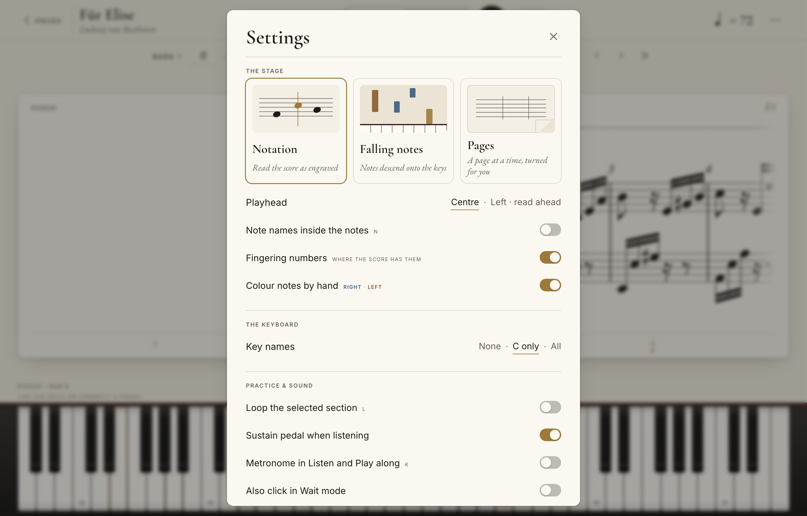
  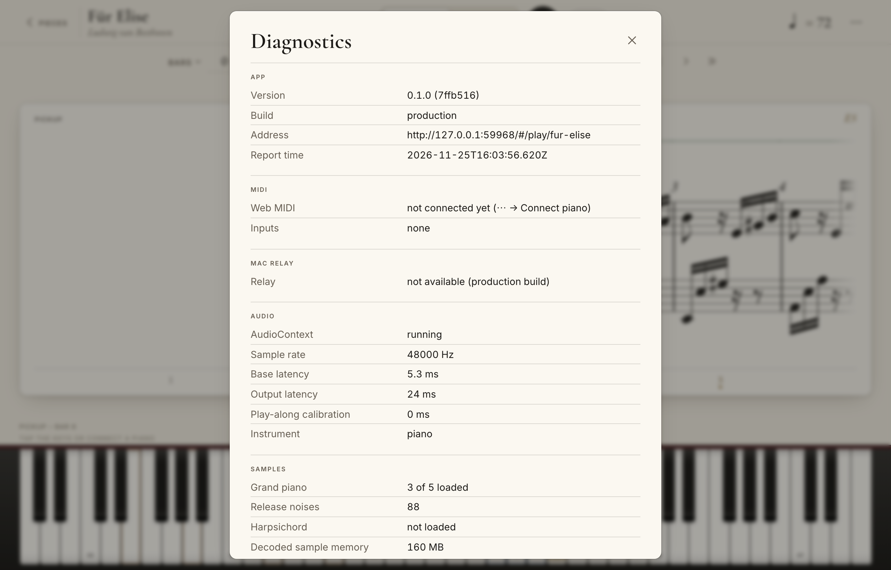
</p>

**Play along says I'm late (or early) when I'm not.** Open a piece's **⋯ → Settings… → Input
latency → Calibrate…** and tap with the clicks; the measured delay (Bluetooth headphones, the
relay) is taken off every note.

**No sound.**
- Browsers start audio only after a tap: press Listen or tap a key once. "Audio unavailable ·
  tap Listen to try again" means exactly that.
- Check ⋯ → *Sound* (**M**) and the system volume. On the iPad, the side switch or Control
  Centre's silent mode can mute web audio.
- The first time, the grand piano's samples (several MB) take a moment to download.

**The app looks out of date after an update.** Reload the page. A production build with the
offline cache fetches the new version in the background; reload once more if it still looks old.

---

## Screenshots

| | | |
| --- | --- | --- |
| [](docs/screenshots/today.png)<br><sub>Today</sub> | [](docs/screenshots/pieces.png)<br><sub>Pieces</sub> | [](docs/screenshots/player.png)<br><sub>Player, notation</sub> |
| [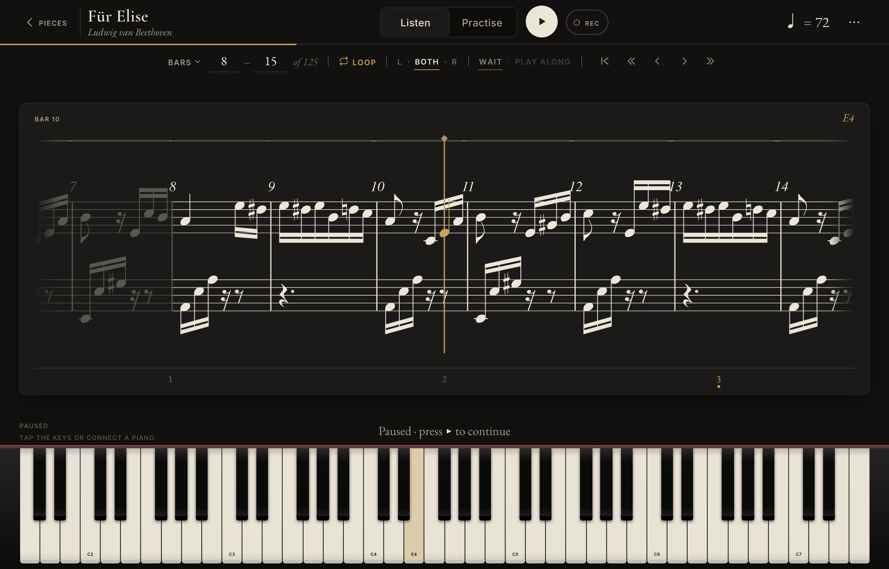](docs/screenshots/player-dark.png)<br><sub>Player, Concert hall</sub> | [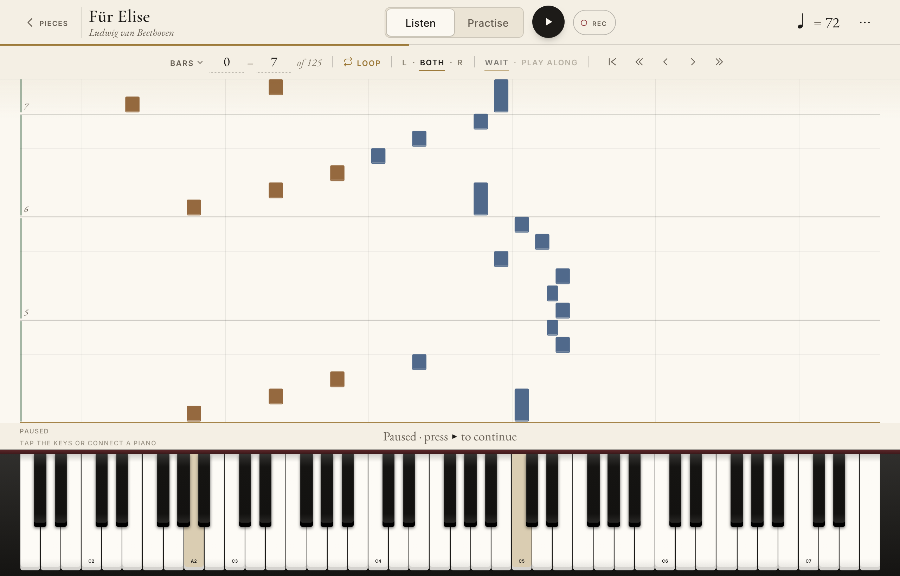](docs/screenshots/falling-notes.png)<br><sub>Falling notes</sub> | [](docs/screenshots/first-look.png)<br><sub>First look</sub> |
| [](docs/screenshots/learn-step.png)<br><sub>Learn step by step</sub> | [](docs/screenshots/results.png)<br><sub>Results: phrasing</sub> | [](docs/screenshots/results-evenness.png)<br><sub>Results: evenness</sub> |
| [](docs/screenshots/exercises.png)<br><sub>Exercises</sub> | [](docs/screenshots/technique-scale.png)<br><sub>Technique</sub> | [](docs/screenshots/reading.png)<br><sub>Note reading</sub> |
| [](docs/screenshots/lessons.png)<br><sub>First lessons</sub> | [](docs/screenshots/theory.png)<br><sub>Theory</sub> | [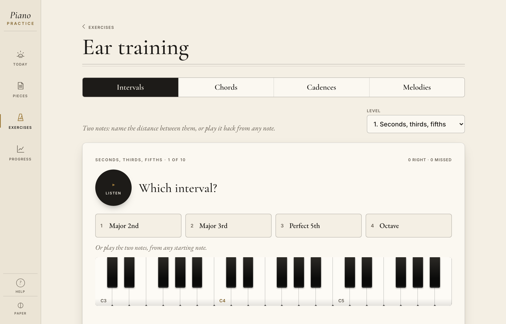](docs/screenshots/ear.png)<br><sub>Ear training</sub> |
| [](docs/screenshots/progress.png)<br><sub>Progress</sub> | [](docs/screenshots/progress-charts.png)<br><sub>Progress: the weeks</sub> | [](docs/screenshots/recording-review.png)<br><sub>Recording review</sub> |
| [](docs/screenshots/teacher.png)<br><sub>Teacher (sample)</sub> | [](docs/screenshots/settings.png)<br><sub>Settings</sub> | [](docs/screenshots/diagnostics.png)<br><sub>Diagnostics</sub> |
| [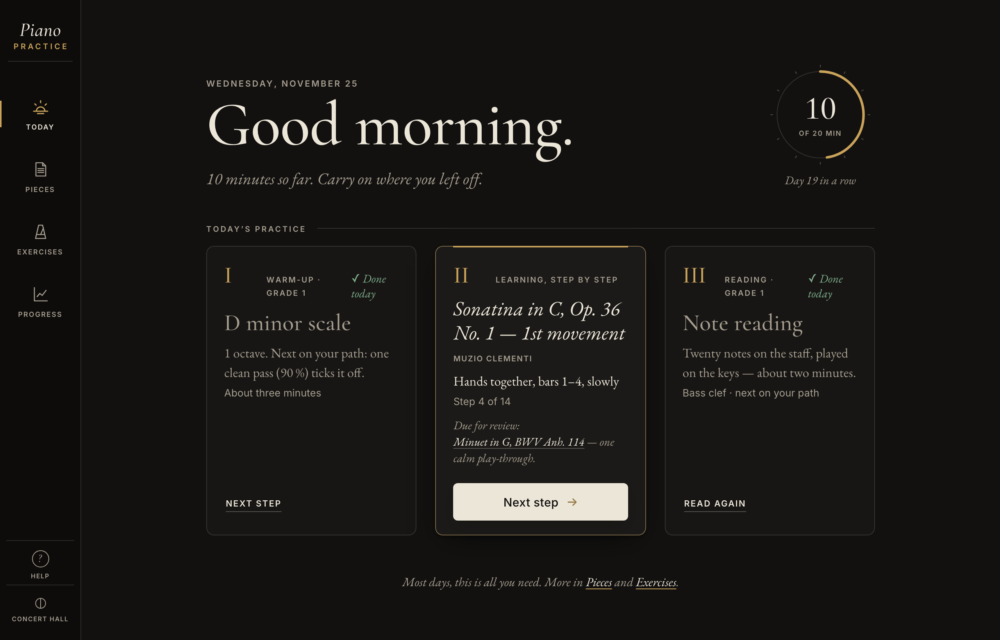](docs/screenshots/today-dark.png)<br><sub>Today, Concert hall</sub> | [](docs/screenshots/ipad-landscape.png)<br><sub>iPad, landscape</sub> | [](docs/screenshots/ipad-portrait.png) [](docs/screenshots/phone-today.png)<br><sub>iPad portrait · phone</sub> |

All of these are regenerated by `npm run screenshots` (see [Scripts](#scripts)) from a production
build with made-up demo practice; none show real progress, private songs or real teacher messages.

---

## For developers

A static web app (Vite, plain ES modules, no framework). Scores are rendered and timed by
[Verovio](https://www.verovio.org) (WebAssembly). The dev server adds small local stores
(progress, imports, recordings, teacher, backup) as Vite plugins; a production build runs
without them and keeps everything in the browser.

### Scripts

Requires Node.js 20 or newer (CI uses Node 22).

| Script | What it does |
| --- | --- |
| `npm run dev` | Dev server on http://localhost:5173 with hot reload and the local stores |
| `npm run dev:ipad` | The same, reachable from the network, with the annotate overlay |
| `npm run build` | Production build into `dist/` (static files, host anywhere; offline cache included) |
| `npm run preview` | Serve the built `dist/` locally |
| `npm run publish:site` | Build for a sub-path and publish it to the public GitHub Pages repo (`--dry-run` to check) |
| `npm test` | Unit tests (Vitest) |
| `npm run e2e` | Build, serve with `vite preview`, run `tests/e2e` in headless, muted Chrome |
| `npm run lint` | ESLint |
| `npm run format` | Prettier |
| `npm run songs` | Compile every `songs/*.notes` to `public/songs/*.musicxml` |
| `npm run screenshots` | Regenerate the README's `docs/screenshots/*.png`: a production build served by `vite preview`, headless muted Chrome at 2× scale, demo data seeded into a throwaway profile (`-- <name>` for some, `-- --list` lists them) |

### Architecture

[`docs/ARCHITECTURE.md`](docs/ARCHITECTURE.md) describes the modules and their contracts
(catalog entries, `loadSong`, `createPlayer`, routes, events, the progress store, teacher hooks,
recordings). [`docs/DESIGN.md`](docs/DESIGN.md) is the visual language ("The Practice Room") and
the four-places rule; [`docs/ROADMAP.md`](docs/ROADMAP.md) tracks the phases.

```
index.html                 app shell markup (player, dialogs); the shell adds the navigation
src/main.js                boot: shell, player, router; the teacher is mounted lazily
src/app/                   shell: router, navigation, Pieces, catalog, imports, theme
src/today/ progress/       Today, Progress (store, mastery, journal, goals)
src/exercises/ trainer/ sightread/ rhythm/ theory/ ear/   the exercises
src/curriculum/            the graded path (Beginner – Grade 5)
src/player.js              the player: listen / practise / MIDI / settings
src/song.js score-core.mjs practice-core.mjs   score loading and pure practice logic
src/highway.js piano.js audio/                 falling notes; the sampled instruments
src/record/                recordings, reports, mock exams
src/teacher/               the Teacher panel (teacher/ holds the CLI and dev-server plugin)
src/help/ onboarding/      the "?" help overlay and the first-launch introduction
src/pwa/                   home-screen app, wake lock, offline cache, backup
src/styles/                tokens.css (the only place colours/fonts live), app.css, shell.css
public/songs/              bundled songs + catalog.json (open licences only)
tools/                     ly2musicxml (Mutopia LilyPond → MusicXML), notes2musicxml, build-repertoire
tests/                     unit tests (Vitest) and e2e tests (tests/e2e, Chrome over CDP)
```

Accessibility and motion: every control is reachable with the keyboard and shows a brass focus
ring; dialogs close with Escape and return focus; token colour pairs meet WCAG AA; animations are
short (≤ 200 ms) and switch off with the system's *reduce motion* setting.

### Adding songs

See [`songs/README.md`](songs/README.md) for the full guide. In short:

- **Bundled songs** live in `public/songs/` and are listed in `public/songs/catalog.json`
  (format in [`docs/ARCHITECTURE.md`](docs/ARCHITECTURE.md)). The graded repertoire is rebuilt
  from `songs/repertoire.json` by `tools/build-repertoire.mjs`.
- **Hand transcriptions** are written in the compact `.notes` format in `songs/` and compiled
  with `npm run songs`.
- **Mutopia Project scores** (LilyPond) can be converted with
  `node tools/ly2musicxml.mjs input.ly > public/songs/name.musicxml`.
- **Your own private songs** go in `public/songs/local/` with their own
  `public/songs/local/catalog.json`. That folder is git-ignored and left out of builds.
- Or use **Import a score** in the app (MusicXML, MXL, MEI or MIDI; see
  [songs/README.md](songs/README.md#importing-a-midi-file) for what a MIDI import can and can't do).

> **Licence rule.** Bundled songs must be public domain or openly licensed, with `license`,
> `source` and `sourceUrl` filled in in the catalog. The licence must cover the *file* (the
> edition or transcription), not just the composition. Copyrighted pieces go in
> `public/songs/local/` and are never committed.

### Annotate overlay (development)

`ANNOTATE=1 npm run dev` (or `npm run dev:ipad`) adds an overlay for leaving notes on the running
app: **Alt+A** to annotate, Cmd/Ctrl+Enter to save. Notes go to `.notes/` (git-ignored); work
through them with `node annotate/notes.js list [--open]` and
`node annotate/notes.js status <n> done "…"`. It is never part of a production build.

### Optional: PDF recognition

Importing a PDF needs a separate local Audiveris (optical music recognition) helper; see
`local-converter/README.md`. It is optional, not bundled, and its results are drafts to check
against the original.

### Contributing

See [CONTRIBUTING.md](CONTRIBUTING.md).

## Licence and credits

The application code is released under the [MIT License](LICENSE).

Third-party components and content keep their own licences; see
[`public/THIRD-PARTY-NOTICES.txt`](public/THIRD-PARTY-NOTICES.txt) (also served with the app).
In particular:

- [Verovio](https://github.com/rism-digital/verovio): LGPL-3.0-or-later
- Salamander Grand Piano V3 samples by Alexander Holm: CC BY 3.0 (five velocity layers and the
  release noises, folded to mono and re-encoded as MP3)
- Harpsichord samples from the [Versilian Community Sample Library](https://github.com/sgossner/VCSL)
  ("Harpsichord, French", Versilian Studios): CC0 1.0
- The room's impulse response and the metronome sounds are generated in code (no recordings)
- Scores from the [Mutopia Project](https://www.mutopiaproject.org), each with its own licence and
  typesetter in `public/songs/catalog.json` (most are public domain; some, such as the Moonlight
  Sonata's first movement typeset by Stewart Holmes, are CC BY-SA, and the converted files keep
  that licence)
